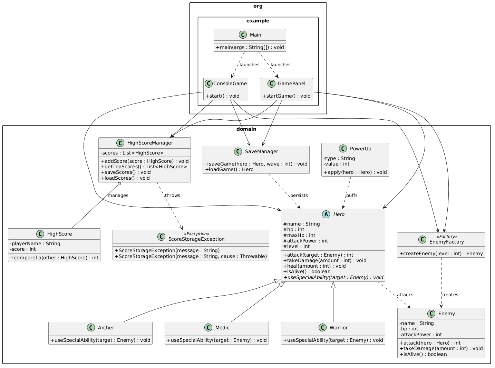

# RPG Játék – Programozás 2 Beadandó

Körökre osztott, Java nyelven készült RPG (szerepjáték) alkalmazás, amely konzolos (`ConsoleGame`) és grafikus (`Java Swing`) felületen is játszható. A projekt célja az objektumorientált programozás (OOP) alapelveinek, tervezési mintáknak, fájlkezelésnek és egységtesztelésnek a gyakorlati bemutatása.

---

## Főbb funkciók

* **Választható hőskasztok:** Harcos (`Warrior`), Íjász (`Archer`) és Gyógyító (`Medic`) — mindegyik eltérő alapértékekkel és saját speciális képességgel.
* **Dinamikus ellenfél-generálás:** Az ellenfelek szinttől/hullámtól függően jönnek létre az `EnemyFactory` segítségével.
* **Power-Up rendszer:** A harcok során gyűjthető bónuszok (`PowerUp`), amelyek növelik a hős életerejét vagy támadóerejét.
* **Mentés és betöltés:** A játékállás fájlba menthető (`savegame.txt`) és később folytatható a `SaveManager` osztályon keresztül.
* **Toplista (High Score):** A legjobb eredmények pontszám szerint rendezve tárolódnak és visszatölthetők (`HighScoreManager`).
* **Kettős felhasználói felület:** Indításkor választható a szöveges konzolos mód és a grafikus Java Swing felület (`GamePanel`).

---

## Architektúra és OOP megoldások

A projekt két fő csomagra tagolódik (`domain` az üzleti logikának és `org.example` a megjelenítésnek/belépési pontnak):

* **Öröklődés és polimorfizmus:** Az absztrakt `Hero` ősosztályból származik a `Warrior`, az `Archer` és a `Medic`, amelyek saját implementációt adnak az absztrakt `useSpecialAbility(Enemy target)` metódusra.
* **Factory tervezési minta:** Az `EnemyFactory` felel az `Enemy` példányok előállításáért az aktuális szint alapján, elválasztva a példányosítás logikáját a játékmenettől.
* **Saját kivételkezelés:** A `ScoreStorageException` egyedi kivétel jelzi a toplista fájlkezelése során fellépő I/O hibákat.
* **Dokumentáció:**
  * [Felhasználói történetek (User Stories)](docs/user_stories.md)
  * [UML forrás (PlantUML)](docs/class_diagram.puml)

### UML Osztálydiagram



---

## Követelmények és futtatás

### Előfeltételek
* **Java JDK 17** vagy újabb
* **Apache Maven** (vagy a projektben található Maven Wrapper: `mvnw`)

### Build, futtatás és tesztelés

A projekt gyökérmappájából futtatható parancsok:

**1. Fordítás (Build):**
```bash
./mvnw clean compile
```
*(Windows PowerShellben: `.\mvnw.cmd clean compile`)*

**2. Tesztek futtatása:**
```bash
./mvnw test
```
*(Windows PowerShellben: `.\mvnw.cmd test`)*

**3. Alkalmazás indítása:**
* **IntelliJ IDEA-ból:** Nyisd meg az `src/main/java/org/example/Main.java` fájlt, és futtasd a `main` metódust.
* **Parancssorból:**
```bash
./mvnw exec:java -Dexec.mainClass="org.example.Main"
```

---

## Projektstruktúra

```text
Prog2Project/
├── docs/
│   ├── class_diagram.png     # UML osztálydiagram (kép)
│   ├── class_diagram.puml    # UML osztálydiagram (PlantUML forrás)
│   └── user_stories.md       # Felhasználói történetek
├── src/
│   ├── main/java/
│   │   ├── domain/           # Üzleti logika (Hero, EnemyFactory, SaveManager, stb.)
│   │   └── org/example/      # Belépési pont és UI (Main, ConsoleGame, GamePanel)
│   └── test/                 # Egységtesztek
├── .gitignore
├── LICENSE
├── pom.xml
└── README.md
```

---

## Tervezési döntések és ismert korlátok

* **Szöveges fájlalapú perzisztencia:** A mentések (`savegame.txt`) és a toplista egyszerű szöveges fájlba íródnak adatbázis helyett, hogy a projekt külső szerver nélkül, bárhol azonnal futtatható legyen. Ezek a futásidejű fájlok a `.gitignore`-ban szerepelnek, így nem szemetelik tele a repót.
* **Különálló üzleti logika:** A `domain` csomag nem függ a Swing UI-tól, így ugyanaz a játéklogika szolgálja ki a konzolos és a grafikus felületet is.
* **Ismert korlátok:** A játék jelenleg egyjátékos módra készült, és egyszerre egy aktív mentési helyet (`savegame.txt`) kezel.

---

## Licenc és készítő

* **Készítette:** Molnár Kristóf József
* **Licenc:** A projekt az **MIT License** feltételei szerint használható fel.
